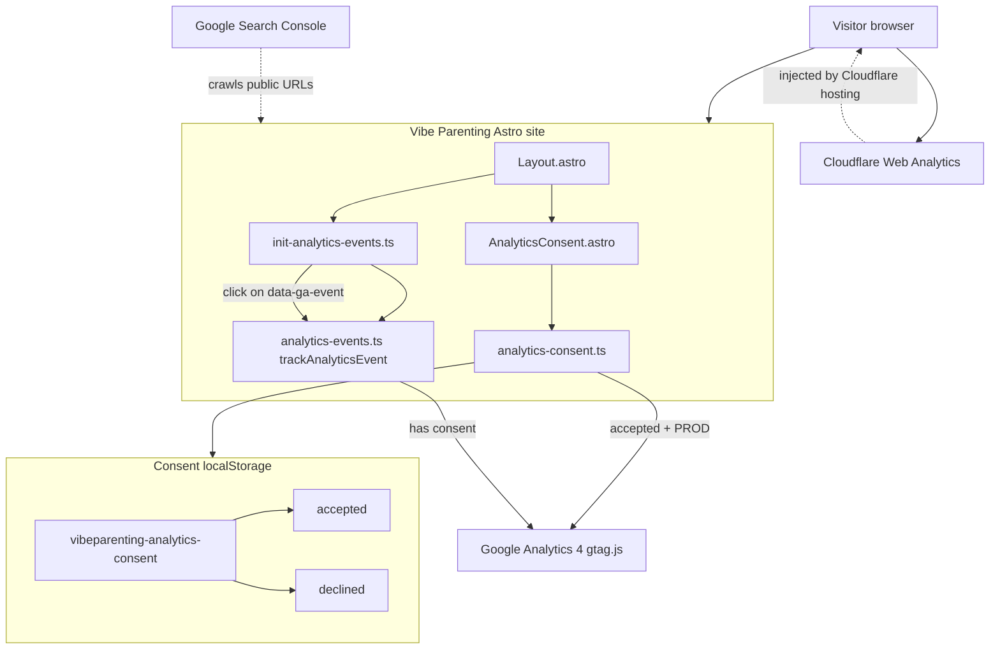

# Analytics architecture

This document describes verified integration points in the Astro application. External dashboard configuration is noted where it cannot be confirmed from the repository.

## Application context

- **Framework:** Astro 7 static site
- **Canonical site URL:** `https://vibeparenting.org` (`astro.config.mjs` → `site`)
- **Shared layout:** `src/layouts/Layout.astro` wraps all primary pages with header, footer, consent UI, and engagement tracking script
- **Production deploy:** Cloudflare Pages (referenced in privacy copy; no `wrangler.toml` in repo)

## Integration overview

## Client-side analytics (Google Analytics 4)

### Load path

1. Every page using `Layout.astro` renders `AnalyticsConsent.astro` and runs `initAnalyticsEngagementTracking()` in a client `<script>`.
2. `initAnalyticsConsent()` in `src/scripts/analytics-consent.ts`:
   - Sets `window['ga-disable-G-YGH3N5GGPF'] = true` until consent and load logic allow otherwise
   - Reads `localStorage` key `vibeparenting-analytics-consent` (`src/lib/consent.ts`)
   - Shows banner when no choice stored; hides after accept/decline
3. On **accept** and `import.meta.env.PROD`:
   - `installGtagStub()` creates standard `dataLayer` + `gtag` queue (`push(arguments)`)
   - Calls `gtag('js', …)` and `gtag('config', measurementId, { send_page_view: true, … })`
   - Injects `https://www.googletagmanager.com/gtag/js?id=G-YGH3N5GGPF`

### Custom events path

1. Instrumented elements expose `data-ga-event` (and optional project attributes).
2. `init-analytics-events.ts` listens on `document` for clicks, finds closest `[data-ga-event]`, calls `trackAnalyticsEvent()`.
3. `trackAnalyticsEvent()` no-ops unless `window.vibeParentingAnalytics.hasAnalyticsConsent()` is true and `gtag` is a function.

### Teardown on decline

`teardownGoogleAnalytics()` disables via `ga-disable-*`, removes gtag script nodes, replaces `gtag` with no-op, clears `dataLayer`, clears `_ga*` / `_gid` / `_gat` cookies where possible.

## Cloudflare Web Analytics (independent path)

Not implemented in application source. Privacy policy and consent UI state that **Cloudflare Web Analytics** is enabled in the Cloudflare dashboard for the live site and is **not** gated by the Google Analytics consent banner.

Expect Cloudflare to inject its beacon on production responses. This path does not use `gtag`, `data-ga-event`, or localStorage consent.

## Google Search Console (independent path)

No runtime JavaScript. Discovery relies on:

- Public HTML at `https://vibeparenting.org`
- `public/robots.txt` → sitemap URL
- Sitemap generated at build time via `@astrojs/sitemap`

Search Console property and DNS verification are operational assumptions documented in [search-console.md](./search-console.md); they are not enforced in code.

## Production vs development

| Behavior | Development (`astro dev`) | Production build + preview / live |
|----------|---------------------------|-----------------------------------|
| GA4 script load on accept | No (`analyticsEnabled: false`) | Yes |
| Consent banner / settings | Yes | Yes |
| Custom event delegation | Runs; events no-op without GA | Sends when consent + gtag loaded |
| Draft projects in routes | All editorial statuses visible | Only `editorialStatus: published` (`isProjectVisible`) |

## Consent-dependent vs independent systems

| System | Depends on GA consent? | Data type |
|--------|------------------------|-----------|
| GA4 page views & custom events | Yes | Client-side, optional |
| GA4 Enhanced Measurement (if enabled in GA4 Admin) | Yes | Client-side, optional |
| Cloudflare Web Analytics | No | Hosting-injected beacon |
| Cloudflare zone / HTTP analytics | No | Edge/server logs |
| Search Console | No | Crawl/index/search telemetry |

## Related documentation

- Events: [events.md](./events.md)
- Consent details: [privacy-and-consent.md](./privacy-and-consent.md)
- GA4 configuration: [google-analytics.md](./google-analytics.md)
